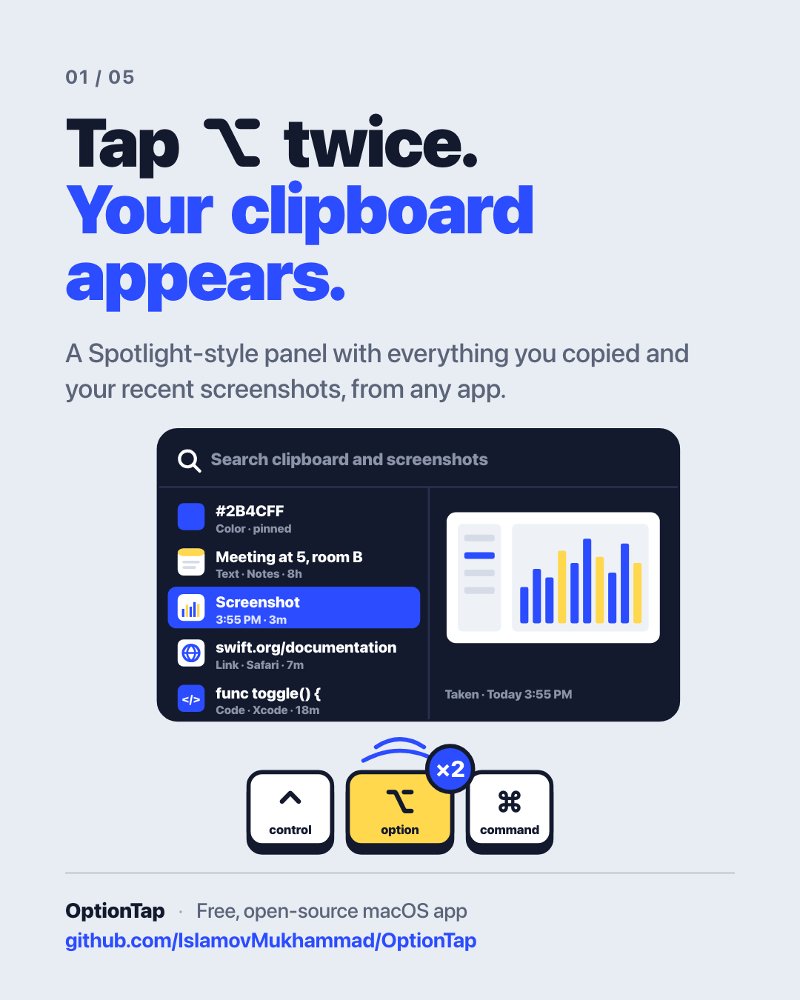
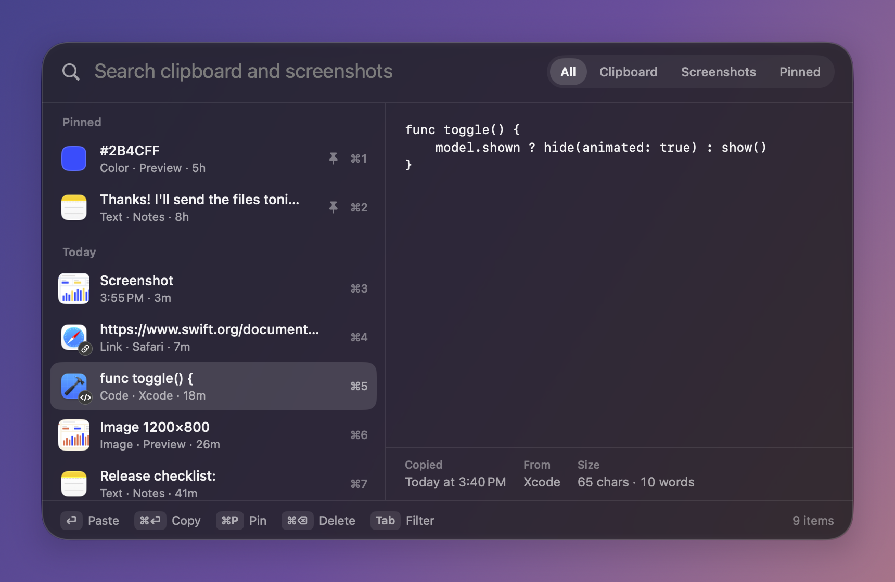
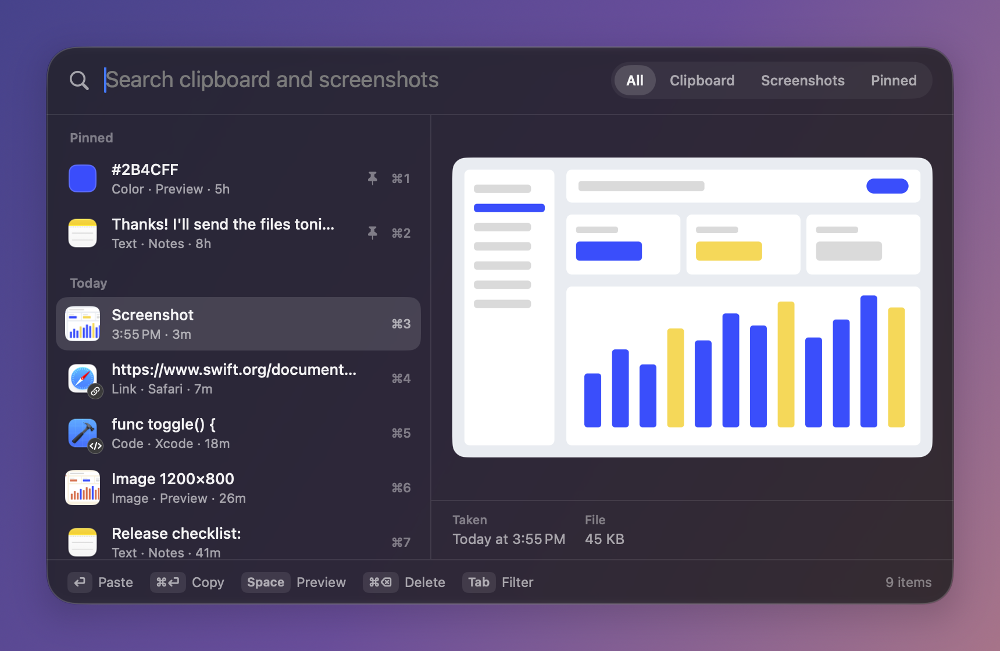
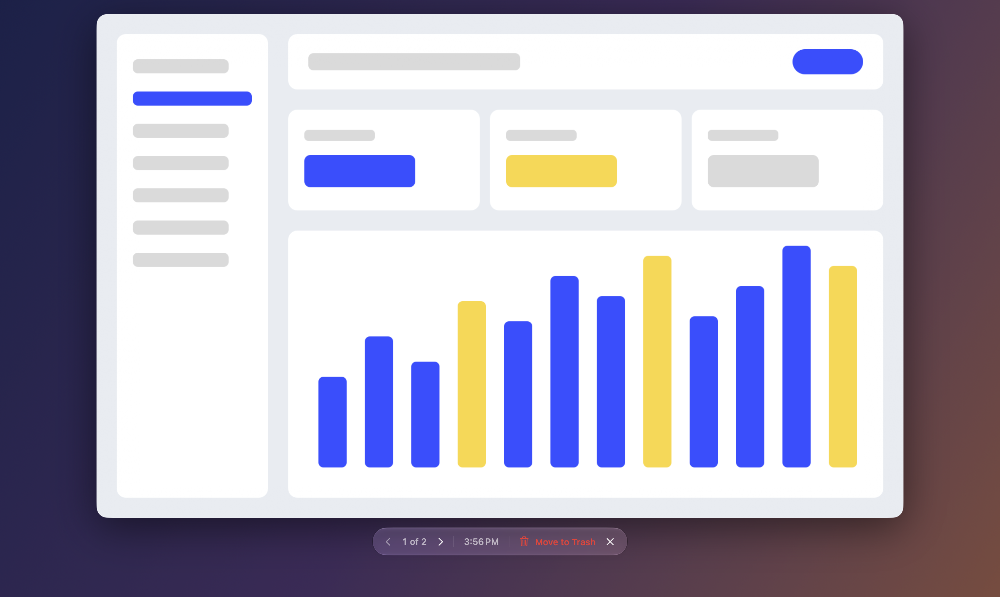
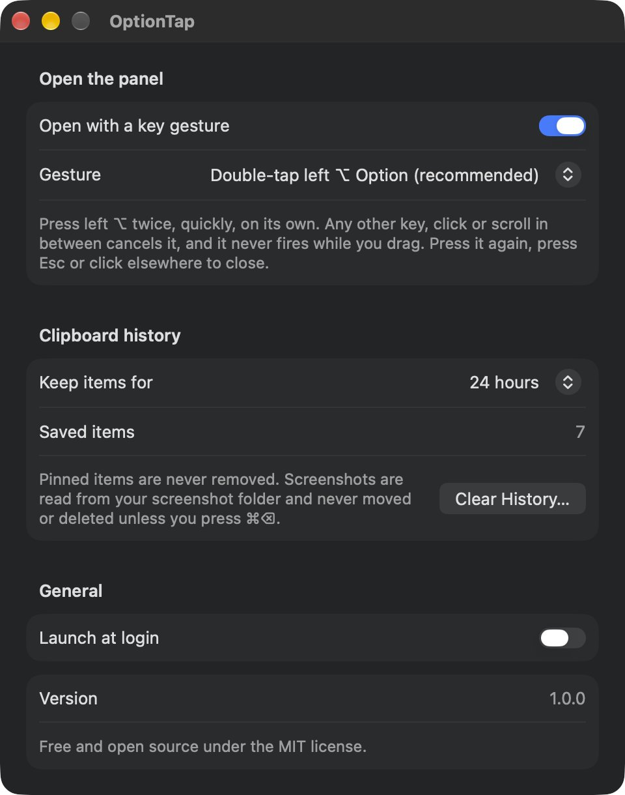

<p align="center">
  
</p>

# OptionTap

[](https://github.com/IslamovMukhammad/OptionTap/actions/workflows/ci.yml)

**Double-tap ⌥ and your clipboard history and recent screenshots are right there.**

A Spotlight-style panel for macOS. Free, open source, lives in the menu bar.

## Features

- **Double-tap Left ⌥** to open a panel in the centre of the screen. Press it again, or Esc, to close.
- **Clipboard history**: text, links, code, colours, images and files. History is saved to disk and survives restarts.
- **No duplicates**: copying the same text or image again moves it to the top.
- **Pin** what you use often. Pinned items never expire; everything else is removed after the history length you choose (1 hour, 24 hours, 7 days or 30 days).
- **Recent screenshots** from the last 24 hours appear in the same list, with a big full-screen preview. You can drag them straight into another app.
- OptionTap never moves or deletes your screenshots on its own. Only ⌘⌫ sends one to the Trash.
- **Keyboard first**: search as you type, ⏎ pastes into the app you were using, ⌘1–9 pastes an item instantly.
- **Password managers respected**: items marked as concealed or transient on the pasteboard are never recorded.
- Filters: All, Clipboard, Screenshots, Pinned.
- Other gestures: double-tap right ⌥, or hold left or right ⌥.
- Launch at login. Native SwiftUI + AppKit, no third-party dependencies.

## Screenshots

<p align="center">
  
</p>
<p align="center">
  
</p>
<p align="center">
  
</p>
<p align="center">
  
</p>

## Keyboard shortcuts

| Key | Action |
|---|---|
| ⌥ ⌥ (double-tap Left Option) | Open / close the panel |
| ↑ ↓ | Move the selection |
| ⏎ | Paste the selected item into the app you were using |
| ⌘⏎ | Copy only (don't paste) |
| ⌘1 – ⌘9 | Paste that item right away |
| ⌘P | Pin / unpin |
| ⌘⌫ | Delete (screenshots go to the Trash) |
| Space | Full-screen preview of a screenshot (when the search is empty) |
| Tab / ⇧Tab | Next / previous filter |
| Esc | Clear the search, then close |

## Requirements

- macOS 26 or later
- Accessibility permission, used to detect the ⌥ gesture and to send ⌘V when pasting (asked on first launch)
- Xcode 26 / Swift 6 toolchain to build

## Build from source

There is no prebuilt download. Build it yourself in a minute:

```bash
git clone https://github.com/IslamovMukhammad/OptionTap.git
cd OptionTap
./build.sh --install   # builds, copies to /Applications and launches
```

`./build.sh` alone puts the app in `build/OptionTap.app`. Run the tests with `swift test`.
The app icon is drawn in code: `swift Scripts/make_icon.swift` regenerates `Resources/AppIcon.iconset`.

If you have no Apple signing certificate the app is signed ad-hoc; macOS may then ask you to re-grant
Accessibility permission after every rebuild.

## How it works

| Part | File |
|---|---|
| Global ⌥ monitor | `Sources/OptionTap/Trigger/KeyTrigger.swift` |
| Pure, unit-tested double-tap / hold detectors | `Sources/OptionTap/Trigger/GestureDetectors.swift` |
| Pasteboard watcher (checks `changeCount` every 0.5 s) | `Sources/OptionTap/Store/ClipboardStore.swift` |
| History rules: dedupe, expiry, pins, limits | `Sources/OptionTap/Store/ClipHistory.swift` |
| Recent screenshots from your screenshot folder | `Sources/OptionTap/Store/ScreenshotStore.swift` |
| Panel window, keyboard handling, paste | `Sources/OptionTap/Panel/QuickPanelController.swift` |
| Panel UI | `Sources/OptionTap/Panel/QuickPanelView.swift` |

The panel is a non-activating window, so the app you were typing in stays in front, and ⏎ pastes
straight back into it. Screenshots are found in the folder set in the Screenshot app (falling back to the
Desktop) by the system's screen-capture tag, so it works in any system language.

## Privacy

Clipboard history stays on your Mac in `~/Library/Application Support/OptionTap`. Nothing leaves the
device. There is no network code, analytics or telemetry. The history folder is readable only by your
user account. **Clear History…** in Settings removes everything except pinned items; to remove all of it,
quit the app and delete that folder.

## Known limitations

- Needs Accessibility permission; ad-hoc builds may need it granted again after each rebuild.
- The pasteboard is checked every 0.5 s, so if you copy twice within half a second only the last copy is kept.
- Rich text is stored as plain text. Only PNG/TIFF images are captured, up to 25 MB and 100 megapixels each.
- At most 300 unpinned items are kept.
- The gesture keys are left or right ⌥ only.
- English UI only.

Bug reports and pull requests are welcome.

## Credits

Originally built as part of the author's personal desk companion app.

## License

[MIT](LICENSE) © 2026 Muhammad Islamov

## Follow

- GitHub: [@IslamovMukhammad](https://github.com/IslamovMukhammad)
- Telegram: [t.me/infinitwo](https://t.me/infinitwo)
